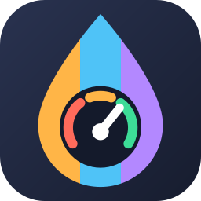
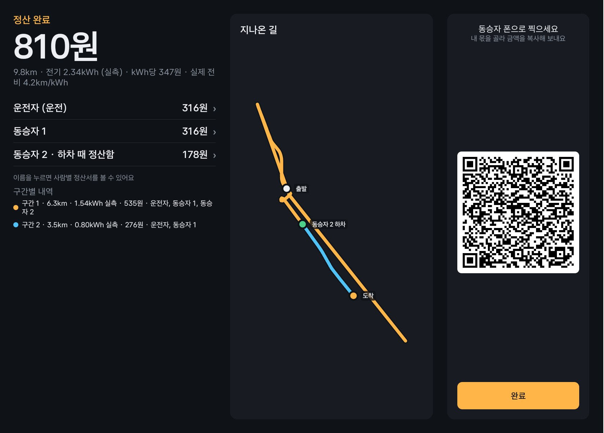

<p align="center">
  
</p>

<h1 align="center">AUTONOMICS</h1>

**함께 탄 구간만큼, 차가 실제로 쓴 연료·전기 값을 나누는 Pleos Connect 차량용 앱.**

여럿이 한 차로 이동하면 기름값은 보통 어림한 금액을 인원수로 나눕니다. AUTONOMICS는 차가 잰 주행거리와 배터리·연료 감소량으로 구간마다 실제 비용을 계산하고, 그 구간에 타고 있던 사람끼리만 나눕니다. 중간에 내리는 사람은 내리는 순간 금액이 확정되고, QR을 찍어 자기 정산서를 받아 갑니다.

- 팀: THR3AD
- 플랫폼: Pleos Connect (Android Automotive OS), Kotlin + Jetpack Compose
- APK: [`apk/THR3AD_AUTONOMICS_release.apk`](apk/THR3AD_AUTONOMICS_release.apk)
- 시연 영상 (2분 16초, 무음 자막): [`docs/proposal/demo-video/AUTONOMICS_demo.mp4`](docs/proposal/demo-video/AUTONOMICS_demo.mp4)
- 기획서: [`docs/proposal/pdf/autonomics-proposal.pdf`](docs/proposal/pdf/autonomics-proposal.pdf)

| 중간 하차 정산 | 도착 정산 |
|---|---|
|  |  |

화면은 Pleos Connect 에뮬레이터에서 실제 SDK 값으로 찍었습니다. 충전 단가를 2026년 8월 개편 요금으로 바꾸기 전에 찍은 것이라 단가가 347원으로 보입니다.

## 정산 방식

시연 영상의 여행을 예로 들면 이렇습니다. 세 명이 출발해 13.3km를 간 뒤 한 명이 내리고, 남은 두 명이 6.3km를 더 갔습니다. 전기 값은 모두 1,612원입니다.

| 구간 | 탄 사람 | 구간 비용 | 한 사람 몫 |
|---|---|---|---|
| 1 (13.3km) | 현우, 유진, 수진 | 1,098원 | 366원 |
| 2 (6.3km) | 현우, 유진 | 514원 | 257원 |

| | 구간 정산 | 인원수로 나눌 때 |
|---|---|---|
| 현우 | 623원 | 537원 |
| 유진 | 623원 | 537원 |
| 수진 (먼저 내림) | 366원 | 537원 |

구간 비용은 `그 구간에서 실제로 쓴 전기(kWh) 또는 연료(L) × 단가`입니다. 사용량은 아래 순서로 고르고, 화면에 실측인지 추정인지 표시합니다.

1. 잔량 센서 감소분. 전기차는 거리 제한 없이 쓰고, 연료차는 센서 해상도가 낮아 20km 이상 구간에서만 씁니다.
2. 센서 값을 쓸 수 없으면 공인 연비·전비와 공회전 시간으로 추정합니다.

## 주요 기능

**정산 모드**
- 출발 전에 동승자 이름을 말로 입력합니다(직접 입력도 가능, 동승자 최대 4명).
- 차종은 차량 데이터로 판별하고, 오늘 단가는 자동으로 채웁니다. 단가는 직접 고칠 수 있습니다.
- 달리는 동안 총액과 사람별 금액이 실시간으로 오릅니다.
- 주행 중에는 조작이 잠기고, 정차하면 열립니다. QR도 정차 중에만 뜹니다.
- 중간 하차: 내리는 사람의 금액을 확정하고 개인 QR을 띄웁니다. 잘못 누르면 되돌릴 수 있습니다.
- 중간 탑승: 정차 중에 사람을 추가하면 그때부터의 구간만 부담합니다.
- 시동을 껐다 켜도 같은 여행으로 이어집니다.
- 도착하면 사람별 금액, 구간별 내역, 지나온 길 지도를 보여 줍니다.

**동승자 폰**
- QR을 찍으면 브라우저에서 정산서가 열립니다. 앱 설치나 가입이 필요 없습니다.
- 낼 금액, 함께 탄 거리, 사용량을 보고 금액을 복사할 수 있습니다.
- 정산 내용은 URL의 `#` 뒤에만 들어 있고 서버에 저장하지 않습니다.

**솔로 모드**
- 혼자 운전할 때 쓴 전기·연료 값과 실제 효율을 보여 줍니다.
- 구간을 자동으로 나누고(2분 정차, 시내↔고속 전환, 지역 변경) 구간별 효율을 공인 값과 비교한 운전 리포트를 만듭니다.

**공통**
- 전기, 휘발유, 경유, 하이브리드를 지원합니다.
- 최근 기록을 다시 열거나 지울 수 있습니다. 기록은 차 안에만 저장합니다.

## 쓰는 차량 데이터

| SDK | 버전 | 쓰는 곳 |
|---|---|---|
| Pleos Vehicle | 2.3.2 | 누적 주행거리, 배터리 에너지, 연료 잔량, 기어 |
| Pleos NaviHelper | 3.0.5 | 현재 위치의 지명 (출발·하차·도착 지점 이름) |
| Pleos SpeechToText | 3.3.1 | 동승자 이름 음성 입력 |
| AAOS Car API | — | 차속, 연료 탱크 용량 |

앱 코드에는 가짜 차량 데이터가 없습니다. 에뮬레이터에서도 값은 모두 Pleos SDK로 읽고, 주행 입력만 Virtual Console과 `tools/emulator_drive.py`로 넣습니다.

## 테스트 환경

| 항목 | 값 |
|---|---|
| 에뮬레이터 | Pleos Connect v2.1 AVD (전기차), 2560×1440 |
| Android | minSdk 30, targetSdk 34 |
| 빌드 | Android Studio 내장 JDK 17, Gradle 래퍼, AGP 8.9.3, Kotlin 2.0.21 |
| 주행 재현 도구 | Python 3 (추가 패키지 없음), `adb` |
| 네트워크 | 오늘 단가 조회와 동승자 정산 페이지에 필요. 없으면 내장 기본 단가를 씁니다 |

실차에서는 확인하지 못했습니다. 모든 확인은 macOS에서 띄운 에뮬레이터로 했고, Windows용 명령은 실행해 보지 못했습니다.

## 실행 방법

### 1. APK 설치

Pleos Connect 에뮬레이터를 켠 뒤 설치합니다.

```bash
adb install -r apk/THR3AD_AUTONOMICS_release.apk
```

앱 목록에서 **AUTONOMICS**를 엽니다. 처음 실행하면 차량·위치·마이크 권한을 묻고, 차량 정보(차종, 공인 효율) 화면이 나옵니다.

APK는 release 빌드이고, 바로 설치되도록 디버그 키로 서명했습니다.

### 2. 주행 입력 준비

에뮬레이터는 Virtual Console에서 속도를 올려도 주행거리와 배터리가 움직이지 않습니다. 주행 재현 도구를 켜 두면 속도에 맞춰 GPS, 누적 주행거리, 배터리가 함께 움직입니다. 경로는 강남역에서 경부고속도로를 따라가는 실제 도로(OpenStreetMap)입니다.

macOS · Linux:

```bash
adb forward tcp:8088 tcp:8088          # Virtual Console: http://localhost:8088
ADB=adb python3 tools/emulator_drive.py
```

Windows (PowerShell):

```powershell
adb forward tcp:8088 tcp:8088          # Virtual Console: http://localhost:8088
$env:ADB = "adb"
python tools\emulator_drive.py
```

`adb`가 PATH에 없으면 `ADB`에 전체 경로를 넣습니다(Windows 기본 위치: `%LOCALAPPDATA%\Android\Sdk\platform-tools\adb.exe`).

### 3. 시연 영상과 같은 흐름 재현

1. 홈에서 `정산 모드`를 누르고 동승자 두 명의 이름을 넣은 뒤 `출발`을 누릅니다.
2. Virtual Console에서 기어를 D로 바꾸고 속도를 올립니다. 앱의 칩이 `주행 중`으로 바뀌고 버튼이 잠기며, 금액이 오르기 시작합니다.
3. 속도를 0으로 내리면 `정차 중`으로 바뀌고 버튼이 열립니다. 내릴 사람을 누르면 하차 정산 카드와 QR이 뜹니다.
4. 폰으로 QR을 찍으면 정산서가 열립니다. `확인`을 누르고 다시 달리면 내린 사람의 금액은 그대로이고 남은 사람만 오릅니다.
5. 정차한 뒤 `여행 종료`를 누르면 사람별 금액, 구간별 내역, 지나온 길이 나옵니다.

더 확인할 수 있는 것:
- 주행 중에 `adb reboot`로 시동 OFF/ON을 흉내 내면, 부팅 뒤 같은 금액에서 여행이 이어집니다(약 70초).
- 정차 중에 `+ 동승자 추가`로 사람을 태우면 0원부터 시작합니다.
- 홈에서 `솔로 모드`로 달린 뒤 종료하면 운전 리포트가 나옵니다.

### 4. 소스에서 빌드

JDK 17이 필요합니다. 아래는 Android Studio에 들어 있는 JDK를 쓰는 방법이고, 경로는 기본 설치 위치 기준입니다.

macOS:

```bash
export JAVA_HOME="/Applications/Android Studio.app/Contents/jbr/Contents/Home"
./gradlew :domain:test          # 정산·구간 기록 규칙 단위 테스트
./gradlew :app:installDebug     # 에뮬레이터에 설치
./gradlew :app:assembleRelease  # app/build/outputs/apk/release/
```

Windows (PowerShell):

```powershell
$env:JAVA_HOME = "C:\Program Files\Android\Android Studio\jbr"
.\gradlew.bat :domain:test          # 정산·구간 기록 규칙 단위 테스트
.\gradlew.bat :app:installDebug     # 에뮬레이터에 설치
.\gradlew.bat :app:assembleRelease  # app\build\outputs\apk\release\
```

Android Studio로 프로젝트를 열어 실행하면 운영체제와 상관없이 위 설정 없이 빌드됩니다.

- `local.properties`에 `sdk.dir`(Android SDK 경로)이 필요합니다. Android Studio로 열면 자동으로 만들어집니다.
- Pleos SDK는 `settings.gradle.kts`에 적힌 Pleos Playground Maven 저장소에서 받습니다.
- API 키 없이 빌드하고 실행할 수 있습니다. `local.properties`에 `kakao.rest.key`를 넣으면 내비 지명이 없을 때 카카오 로컬 API로 지명을 보충합니다(선택).

## 구조

```
:app ──▶ :data  ──▶ :domain
  │  └─▶ :pleos ──▶ :domain
  └──────────────▶ :domain
```

| 모듈 | 하는 일 |
|---|---|
| `:domain` | 순수 Kotlin. 모델, 정산 규칙(`SettlementCalculator`, `EnergyModel`), 구간 기록(`TripRecorder`), 여행 진행(`TripSession`), 저장소 인터페이스 |
| `:pleos` | Pleos SDK 어댑터. 차량 값, 내비 지명, 음성 입력 |
| `:data` | 여행 기록(Room), 진행 중 여행 파일, 단가 조회, 지명 조회 |
| `:app` | Compose 화면, `MainViewModel`, 포그라운드 서비스, 부팅 리시버, 수동 DI(`AppContainer`) |

정산 규칙은 Android와 SDK에 의존하지 않는 `:domain`에 있고 단위 테스트로 확인합니다. 의존 방향과 이름 규칙은 `tools/check_conventions.py`가 커밋 전에 검사합니다.

그 밖의 폴더:

| 경로 | 내용 |
|---|---|
| `web/s.html` | 동승자 정산 페이지 (정적 페이지 한 장) |
| `netlify/functions/prices.mjs` | 오늘 유가(오피넷 전국 평균)와 공공 충전 요금을 내려주는 함수. 오피넷 키는 서버 환경 변수에만 둡니다 |
| `tools/emulator_drive.py` | 에뮬레이터 주행 재현 도구 |
| `docs/proposal/` | 기획서, 시연 영상, 촬영·편집 스크립트 |

## 제약과 알려진 한계

- **실차 미검증**: 에뮬레이터에서만 확인했습니다.
- **휘발유·경유·하이브리드**: 에뮬레이터가 전기차라 연료 잔량을 받을 수 없습니다. 이 차종의 계산은 단위 테스트로만 확인했습니다. 경유는 차량 데이터로 구분할 수 없어 사용자가 고릅니다.
- **지명**: 에뮬레이터의 내비 위치는 GPS를 따라가지 않고 한 곳에 고정돼 있어, 지점 이름이 실제 경로와 다르게 나옵니다. 지도의 경로는 GPS 기준이라 맞게 그려집니다.
- **충전 단가**: 기본값은 공공 급속(100~200kW) 고시 요금 348.4원/kWh(2026-08-01 시행)이고, 운전자가 실제로 낸 요금이 아닙니다. 출발 화면에서 고칠 수 있습니다.
- **통행료·주차비**: 화면에서 입력할 수 없습니다. 연료·전기 값만 나눕니다.
- **송금**: 앱은 금액까지만 알려 줍니다. 송금은 각자 쓰는 앱으로 합니다.
